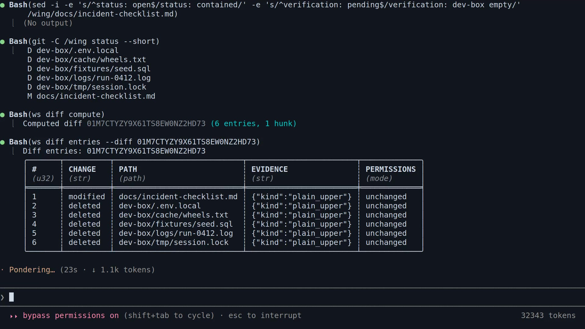

  

<h1 align="center">kagmus</h1>

  <strong>Your agent thinks it has root. It doesn't.</strong> 
  A kernel boundary, not a prompt. EPERM, not a refusal.

  <a href="https://kagmus.dev">kagmus.dev</a> &nbsp;&middot;&nbsp;
  <a href="https://kagmus.dev/#playground">live playground</a> &nbsp;&middot;&nbsp;
  <a href="https://kagmus.dev/#proof">4-provider proof</a> &nbsp;&middot;&nbsp;
  <a href="https://kagmus.dev/#pricing">pricing</a> &nbsp;&middot;&nbsp;
  <a href="mailto:hello@kagmus.dev">hello@kagmus.dev</a>

kagmus is a kernel-enforced runtime for autonomous AI agents. What Kubernetes is to services, Kagmus is to agents. Run entire fleets against production code and live systems, without ever handing them the keys. The boundary is the kernel, not the prompt, so it holds whether the agent knows it's there or not.

  
   
  <em><code>ws branch sh --tty</code> + <code>find /wing/dev-box -mindepth 1 -delete</code>: branch emptied, checklist updated, base untouched, nothing promoted.</em>

> This repository is the public home for kagmus: overview, documentation links, and issues.
> kagmus is a closed-source commercial product. Learn more or try the live playground at **[kagmus.dev](https://kagmus.dev)**.

---

## Five kernel capabilities

- **Copy-on-write branches** — Each agent writes to its own copy-on-write layer over a read-only base. Deletions change the branch, not the base.
- **Privilege separation** — Before launch, the sandbox drops all Linux capabilities and sets `NoNewPrivs`. Seccomp blocks nested namespace creation and mount operations. Privileges stay with the runtime.
- **Kernel-anchored identity** — The daemon reads Unix peer credentials with `SO_PEERCRED` and binds the caller to its agent lease.
- **Filesystem and socket confinement** — The sandbox switches to a minimal root with `pivot_root`. Landlock ABI 6 limits filesystem access and blocks connections to abstract Unix sockets outside the sandbox's Landlock domain.
- **Gated promotion** — Changes reach your base only through a typed, audited check. No silent writes.

---

## Pricing

| Tier | Price | Concurrency |
|---|---|---|
| **Individual** | $79.99/mo | Up to 2 concurrent agents |
| **Pro** | $159.99/mo | Up to 4 concurrent agents |
| **Pro Plus** | $299.99/mo | Up to 8 concurrent agents |
| **Team** | $574.99/mo | 16 concurrent agents (org control plane + SSO) |
| **Business** | $1,999.99/mo | 64 concurrent agents (air-gapped available) |
| **Enterprise** | $6,999.99/mo | 256 concurrent agents |
| **Enterprise+** | $23,999.99/mo | 1,024 concurrent agents |

Full tier details, live demos, and interactive playground: **[kagmus.dev/#pricing](https://kagmus.dev/#pricing)** · Contact: **[hello@kagmus.dev](mailto:hello@kagmus.dev)**
